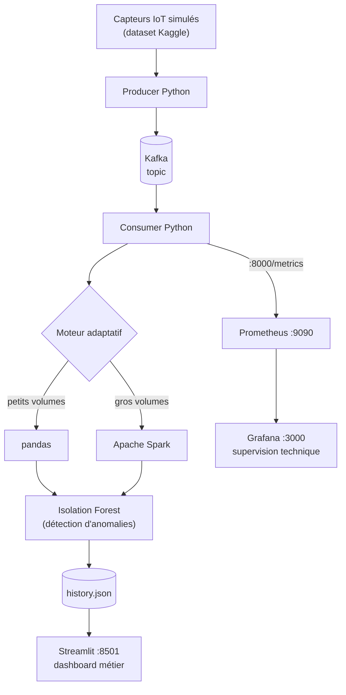

# Smart Data Pipeline

**Conception et implémentation d'un pipeline de données intelligent et auto-adaptatif pour la gestion dynamique des flux de données**

[]()
[]()
[]()
[]()
[]()
[](LICENSE)

> Plateforme de monitoring de flux IoT en temps réel qui **bascule automatiquement entre Pandas et Spark** selon la charge, **détecte les anomalies** par Machine Learning (Isolation Forest) et offre une **double visualisation** : un dashboard métier (Streamlit) et une supervision technique (Prometheus + Grafana).

---

## Sommaire

- [Présentation](#présentation)
- [Démarrage rapide](#démarrage-rapide)
- [Contexte et problématique](#contexte-et-problématique)
- [Notions de base](#notions-de-base)
- [État de l'art](#état-de-lart)
- [Architecture du système](#architecture-du-système)
- [Couche d'ingestion — Kafka](#couche-dingestion--kafka)
- [Couche de traitement adaptatif](#couche-de-traitement-adaptatif)
- [Détection d'anomalies — Isolation Forest](#détection-danomalies--isolation-forest)
- [Visualisation métier — Streamlit](#visualisation-métier--streamlit)
- [Supervision technique — Prometheus & Grafana](#supervision-technique--prometheus--grafana)
- [Conteneurisation — Docker](#conteneurisation--docker)
- [Flux de données complet](#flux-de-données-complet)
- [Résultats et performances](#résultats-et-performances)
- [Environnement de test](#environnement-de-test)
- [Limites du système](#limites-du-système)
- [Installation et déploiement](#installation-et-déploiement)
- [Structure du dépôt](#structure-du-dépôt)
- [Dataset utilisé](#dataset-utilisé)
- [Perspectives](#perspectives)
- [Bibliographie](#bibliographie)
- [Licence](#licence)
- [Comment citer ce projet](#comment-citer-ce-projet)
- [Auteures & encadrement](#auteures--encadrement)

---

## Présentation

**Smart Data Pipeline** est un projet de fin d'études (PFE) de la filière DUT Ingénierie des Données, réalisé à l'**EST El Kelâa des Sraghna — Université Cadi Ayyad**. Il consiste à concevoir une plateforme capable d'ingérer, traiter, analyser et visualiser un flux de données IoT en temps réel, tout en s'adaptant dynamiquement à la charge entrante.

| | |
|---|---|
| **Type** | Projet de Fin d'Études (PFE) |
| **Soutenance** | 16 juin 2026 |
| **Établissement** | EST El Kelâa des Sraghna — Université Cadi Ayyad |
| **Filière** | DUT Ingénierie des Données |
| **Auteures** | BOUDALLAA Samah · EL BAHLOUL Chaymae · EL BASRI Khadija |
| **Encadrant pédagogique** | Pr. Anas Berka |
| **Examinateur** | Pr. Soufiane Mouchtabih |
| **Code source** | [github.com/Samah-boudallaa/smart-data-pipeline-pfe](https://github.com/Samah-boudallaa/smart-data-pipeline-pfe) |
| **Licence** | [MIT](LICENSE) |

### Points clés

| Caractéristique | Détail |
|---|---|
| Moteur adaptatif | Bascule automatique **Pandas ↔ Spark** selon le volume |
| Détection d'anomalies | **Isolation Forest** (Machine Learning) |
| Ingestion | **Apache Kafka 3.7.0** (mode KRaft) |
| Dashboard métier | **Streamlit** (port 8501), thème clair/sombre |
| Supervision technique | **Prometheus** (port 9090) + **Grafana** (port 3000) |
| Déploiement | **Docker Compose**, une seule commande |
| Dataset | IoT Telemetry Data (Kaggle) |
| Latence d'ingestion | **< 100 ms** en local |
| Taux d'anomalies observé | **4–5 %** du flux entrant |
| Durée moyenne de traitement | **< 500 ms** par message |

---

## Démarrage rapide

```bash
git clone https://github.com/Samah-boudallaa/smart-data-pipeline-pfe.git
cd smart-data-pipeline-pfe
docker-compose up --build
```

Une fois les conteneurs démarrés :

| Service | URL |
|---|---|
| Dashboard Streamlit | http://localhost:8501 |
| Prometheus | http://localhost:9090 |
| Grafana | http://localhost:3000 |
| Métriques brutes du consumer | http://localhost:8000/metrics |

Pour arrêter la plateforme : `docker-compose down`.

---

## Contexte et problématique

L'explosion des données générées par les entreprises, les réseaux sociaux, les systèmes IoT et les applications web a entraîné une croissance exponentielle des volumes à traiter, au cœur du phénomène **Big Data**. Les systèmes traditionnels atteignent leurs limites en matière de **scalabilité**, de **latence** et de **traitement en temps réel**. Les pipelines classiques, souvent **statiques**, s'adaptent mal aux variations de charge : performances dégradées et ressources mal utilisées.

> **Comment concevoir un pipeline capable de s'adapter automatiquement aux variations des flux tout en garantissant des performances stables ?**

Le projet répond à cette question par un **pipeline intelligent et auto-adaptatif**, capable de gérer des flux dynamiques tout en maintenant des performances optimales.

---

## Notions de base

### Big Data : les 5V

| V | Signification |
|---|---|
| **Volume** | Quantité massive de données générées chaque jour |
| **Vélocité** | Vitesse de production et de traitement |
| **Variété** | Formats hétérogènes (structurés, semi-structurés, non structurés) |
| **Véracité** | Qualité et fiabilité des données |
| **Valeur** | Capacité à en extraire des informations pertinentes |

### Data pipeline

Architecture qui **déplace, transforme et stocke** automatiquement les données, des sources jusqu'aux systèmes d'analyse. Ses composants principaux sont les sources (bases, APIs, capteurs), les moteurs de traitement et les systèmes de stockage/visualisation.

### Batch vs Streaming

| Critère | Batch | Streaming |
|---|---|---|
| Latence | Élevée | Faible |
| Usage | Analytique | Temps réel |
| Complexité | Moyenne | Élevée |

> Ce projet privilégie le **streaming** pour répondre aux exigences de réactivité.

### Pipelines intelligents et auto-adaptatifs

Un pipeline intelligent analyse son propre fonctionnement et ajuste ses paramètres selon les métriques observées :

- **collecte de métriques** : latence, débit, taux d'erreur ;
- **comparaison avec des objectifs de service** (SLA/SLO) ;
- **ajustement automatique** des ressources et des configurations.

---

## État de l'art

### Architectures de traitement

| Architecture | Principe | Exemple / Créateur | Avantages | Inconvénients | Adaptée pour |
|---|---|---|---|---|---|
| **Batch** | Traitement différé en lots | Hadoop | Traitement massif, robustesse | Latence élevée, pas de temps réel | Analyses historiques, reporting |
| **Lambda** | Batch + temps réel + couche de service | Nathan Marz | Précision, faible latence | Complexité, maintenance lourde | Précision + rapidité |
| **Kappa** | Streaming uniquement | Jay Kreps / Apache Kafka | Simplicité, cohérence, temps réel | Moins adapté aux gros volumes historiques | Applications temps réel, événements |

### Outils retenus

| Outil | Rôle | Avantages | Limites |
|---|---|---|---|
| **Apache Kafka** | Streaming distribué (Producer → Broker → Consumer) | Scalabilité, tolérance aux pannes, faible latence | Configuration complexe |
| **Apache Spark** | Traitement distribué (Core, SQL, Streaming, MLlib) | Rapide en mémoire, agrégations massives | Forte consommation mémoire |
| **pandas** | Manipulation de données tabulaires | Simple, rapide sur petits volumes | Non distribué |
| **Streamlit** | Visualisation interactive métier | Développement rapide, interface intuitive | Peu adapté aux très gros datasets |
| **Prometheus** | Collecte de métriques en séries temporelles | Léger, scraping HTTP natif, PromQL | Métriques numériques uniquement |
| **Grafana** | Dashboards de métriques | Interactif, alertes configurables | Nécessite une source externe |
| **Docker** | Conteneurisation | Portabilité, isolation, reproductibilité | Courbe d'apprentissage |

### Positionnement du projet

Architecture inspirée du **modèle Kappa** : Kafka pour l'ingestion, un **moteur adaptatif** (Pandas ou Spark), Streamlit pour la visualisation métier, Prometheus et Grafana pour la supervision, Docker pour le déploiement. Elle répond aux exigences de temps réel, modularité, évolutivité, observabilité et simplicité d'exploitation.

---

## Architecture du système

Le cycle de vie des données est organisé en couches : **ingestion → traitement → analyse → stockage → visualisation → supervision**.



Tous les services sont conteneurisés et orchestrés par Docker Compose.

### Sources de données

Les données proviennent d'une **simulation de capteurs IoT** basée sur le dataset public **IoT Telemetry Data** (Kaggle) : température, humidité, monoxyde de carbone (CO), fumée, GPL, lumière et mouvement. Elles sont émises sous forme de **messages JSON** par un script Python jouant le rôle de producteur.

---

## Couche d'ingestion — Kafka

Les messages sont publiés dans un **topic Kafka**, ce qui permet de gérer un flux continu, de **découpler producteurs et consommateurs** et d'assurer une transmission fiable. Un **consumer Python** récupère les messages et les transmet aux modules de traitement, pour un traitement **asynchrone et scalable**.

---

## Couche de traitement adaptatif

### Moteur Pandas (petits volumes)

Nettoyage, transformation des variables, statistiques simples, préparation pour l'analyse.

### Moteur Spark (gros volumes)

Traitement de volumes importants, calculs distribués, meilleure scalabilité.

### Moteur d'adaptation intelligent

Un module de décision analyse le **volume de données**, la **fréquence d'arrivée des messages** et les **performances du traitement**, puis sélectionne automatiquement le moteur le plus approprié.

| Volume de données | Moteur sélectionné | Comportement observé |
|---|---|---|
| < 10 000 lignes | Pandas | Très rapide (< 1 s) |
| > 50 000 lignes | Spark | Plus stable et scalable |

> Entre 10 000 et 50 000 lignes, le choix dépend de la fréquence d'arrivée et des performances mesurées.

---

## Détection d'anomalies — Isolation Forest

Un module basé sur **Isolation Forest** (Machine Learning, non supervisé) permet d'identifier des comportements inhabituels et des valeurs aberrantes dans le flux IoT. Les variables d'entrée sont `temp`, `humidity`, `co`, `lpg` et `smoke`. Les résultats sont ajoutés aux données traitées et stockés dans un fichier JSON historique (`history.json`), mis à jour à chaque analyse.

---

## Visualisation métier — Streamlit

Le tableau de bord (port **8501**) permet de :

- afficher les données reçues en temps réel ;
- visualiser les statistiques générées par le pipeline ;
- repérer visuellement les anomalies ;
- basculer entre thème **sombre** et **clair** ;
- régler l'intervalle de rafraîchissement et la sensibilité de détection ;
- réinitialiser les données (avec confirmation).

---

## Supervision technique — Prometheus & Grafana

### Prometheus (port 9090)

Le consumer expose `:8000/metrics` via `prometheus_client`, scrapé toutes les **15 secondes**.

| Métrique | Description |
|---|---|
| `kafka_messages_total` | Nombre total de messages reçus depuis Kafka |
| `anomalies_total` | Nombre total d'anomalies détectées |
| `iot_temperature_celsius` | Dernière température reçue |
| `taux_anomalies_percent` | % d'anomalies sur les 100 derniers messages |
| `moteur_traitement` | Moteur actif (0 = Pandas, 1 = Spark) |
| `historique_taille` | Nombre d'enregistrements dans l'historique |
| `traitement_duree_secondes` | Durée de traitement de chaque message |
| `kafka_connection_status` | État de la connexion au broker (1 = connecté) |

### Grafana (port 3000)

Grafana utilise Prometheus comme source de données et se rafraîchit toutes les **5 secondes**.

| Panneau | Description |
|---|---|
| Statut Kafka | Indicateur Connecté/Déconnecté |
| Messages reçus | Compteur cumulatif |
| Anomalies détectées | Compteur avec seuils colorés (vert/orange/rouge) |
| Taux d'anomalies | Pourcentage avec alertes visuelles |
| Moteur actif | Pandas ou Spark |
| Température IoT | Jauge circulaire, zones colorées 0–60 °C |
| Évolution température | Série temporelle en °C |
| Taux messages/sec | Débit instantané via `rate()` |
| Durée de traitement | Durée moyenne (histogramme) |

---

## Conteneurisation — Docker

| Conteneur | Rôle |
|---|---|
| Kafka | Gestion des flux de messages |
| Spark | Traitement distribué |
| Application Python | Traitement et analyse |
| Streamlit | Interface métier |
| Prometheus | Collecte des métriques |
| Grafana | Visualisation des métriques |

L'ensemble est orchestré par **Docker Compose** : toute la plateforme démarre en une commande.

---

## Flux de données complet

1. Les capteurs IoT simulés génèrent des données, lues par le producteur Kafka.
2. Le producteur publie les messages dans un topic Kafka.
3. Le consommateur récupère les messages et les transmet au module de traitement.
4. Le moteur adaptatif choisit Pandas ou Spark selon la charge.
5. Le module Isolation Forest analyse les données.
6. Les résultats sont enregistrés dans `history.json`.
7. Streamlit lit l'historique et l'affiche dans le dashboard.
8. Prometheus collecte les métriques du consumer et les met à disposition de Grafana.
9. Grafana affiche en temps réel messages traités, anomalies, température et durée de traitement.

---

## Résultats et performances

### Validation de l'ingestion

- messages reçus **sans perte** ;
- latence **< 100 ms** en local ;
- envoi simultané de plusieurs messages supporté.

### Métriques observées pendant les tests

| Métrique | Valeur observée | Signification |
|---|---|---|
| `kafka_messages_total` | 28 400+ | Messages traités depuis le démarrage |
| `anomalies_total` | 1 460+ | Anomalies détectées |
| `taux_anomalies_percent` | 4–5 % | Taux stable, conforme aux attentes |
| `iot_temperature_celsius` | 20–40 °C | Plage normale des capteurs |
| `moteur_traitement` | 1 (Spark) | Basculement vers Spark confirmé |
| `kafka_connection_status` | 1 | Connexion Kafka active |

### Performances de traitement

- **Pandas** est plus rapide sur les petits volumes ;
- **Spark** devient plus performant à mesure que le volume augmente ;
- durée moyenne de traitement **< 500 ms** pour la majorité des messages.

### Scalabilité

Le système peut évoluer horizontalement grâce à la nature distribuée de Kafka, au parallélisme de Spark et à la conteneurisation Docker.

> Les tests ont été réalisés en environnement **local**, ce qui limite la simulation d'un cluster réel.

### Discussion

1. L'architecture est **fonctionnelle et stable**.
2. Le système répond aux **exigences initiales**.
3. L'approche adaptative **améliore l'efficacité**.
4. Les conteneurs **simplifient le déploiement**.
5. Prometheus + Grafana apportent une **observabilité complète** du pipeline.

Par rapport à une architecture sans supervision, la solution offre une visibilité complète sur l'état interne, une détection proactive des dysfonctionnements et une traçabilité historique des métriques. L'usage d'outils standards de l'industrie rend le monitoring extensible : de nouvelles métriques s'ajoutent facilement dans le consumer.

---

## Environnement de test

| Composant | Détail |
|---|---|
| Système d'exploitation | Ubuntu (WSL) |
| Conteneurisation | Docker & Docker Compose |
| Broker de messages | Apache Kafka 3.7.0 (mode KRaft) |
| Langage | Python 3.10 |
| Bibliothèques | `kafka-python`, `pandas`, `pyspark`, `prometheus_client` |
| Interface utilisateur | Streamlit (port 8501) |
| Supervision | Prometheus (9090), Grafana (3000) |
| Machine locale | 16 Go RAM, processeur i5 |

---

## Limites du système

- tests réalisés **uniquement en local** ;
- absence de **cluster Spark distribué réel** ;
- pas de **base de données persistante** (stockage JSON) ;
- **sécurité non implémentée** (pas d'authentification Kafka) ;
- **alertes Grafana** non configurées.

---

## Installation et déploiement

### Prérequis

- Docker & Docker Compose
- Python 3.10+ (uniquement pour une exécution hors conteneur)

### Déploiement complet

```bash
git clone https://github.com/Samah-boudallaa/smart-data-pipeline-pfe.git
cd smart-data-pipeline-pfe
docker-compose up --build
```

Cette commande démarre Kafka, les services de traitement (producer, consumer, moteur adaptatif), Streamlit, Prometheus et Grafana.

### Vérification rapide

Dans Prometheus (http://localhost:9090), exécuter :

```promql
up{job="smart-pipeline-consumer"}
```

Le résultat doit être `1`, ce qui confirme que le consumer est bien supervisé.

### Dépannage

| Problème | Piste de solution |
|---|---|
| Un port est déjà utilisé (8501, 9090, 3000, 8000) | Arrêter le service en conflit ou modifier le mapping de ports dans `docker-compose.yml` |
| Le consumer ne se connecte pas à Kafka | Attendre le démarrage complet du broker, puis consulter `docker-compose logs consumer` |
| Aucune donnée dans Grafana | Vérifier que la cible `smart-pipeline-consumer` est `UP` dans Prometheus (*Status → Targets*) |
| Mémoire insuffisante avec Spark | Allouer davantage de RAM à Docker/WSL (16 Go utilisés pour les tests) |

---

## Structure du dépôt

```
smart-data-pipeline-pfe/
├── data/                         # Dataset IoT et fichiers JSON historiques
├── docs/                         # Documentation (schémas d'architecture, notes)
├── src/                          # Producer, consumer, moteur adaptatif, anomalies
├── .dockerignore
├── .gitignore
├── Dockerfile.app                # Image du dashboard Streamlit
├── Dockerfile.consumer           # Image du consommateur Kafka
├── Dockerfile.producer           # Image du producteur Kafka
├── app.py                        # Dashboard Streamlit
├── docker-compose.yml            # Orchestration des services
├── prometheus.yml                # Cibles de scraping Prometheus
├── requirements.txt              # Dépendances (app + consumer)
├── requirements_producer.txt     # Dépendances (producteur)
├── LICENSE                       # Licence MIT
└── README.md
```

> Le dépôt compte **58 commits** sur **2 branches**, fruit d'un développement itératif mené via Git/GitHub.

---

## Dataset utilisé

**IoT Telemetry Data** (Kaggle, Gary Stafford), au format CSV, 9 colonnes de mesures de capteurs.
Lien : [kaggle.com/datasets/garystafford/environmental-sensor-data-132k](https://www.kaggle.com/datasets/garystafford/environmental-sensor-data-132k)

| Colonne | Type | Description |
|---|---|---|
| `ts` | float | Horodatage Unix de la mesure |
| `device` | string | Identifiant du capteur |
| `co` | float | Monoxyde de carbone |
| `humidity` | float | Humidité relative (%) |
| `light` | boolean | Présence de lumière ambiante |
| `lpg` | float | Gaz de pétrole liquéfié (GPL) |
| `motion` | boolean | Détection de mouvement |
| `smoke` | float | Concentration en fumée |
| `temp` | float | Température (°C) |

### Extrait

| device | temp | humidity | co | lpg | smoke | motion |
|---|---|---|---|---|---|---|
| b8:27:eb:bf:9d:51 | 22.7 | 51.0 | 0.00468 | 0.00762 | 0.01975 | false |
| 00:0f:00:70:91:0a | 19.7 | 46.0 | 0.00414 | 0.00675 | 0.01748 | false |
| b8:27:eb:bf:9d:51 | 23.1 | 52.0 | 0.00485 | 0.00790 | 0.02047 | true |

### Utilisation dans le pipeline

- le producteur lit le CSV séquentiellement pour simuler un flux continu ;
- `temp`, `humidity`, `co`, `lpg` et `smoke` alimentent le moteur adaptatif et le modèle Isolation Forest ;
- `temp` est exposée à Prometheus (`iot_temperature_celsius`) et visualisée dans Grafana ;
- les résultats enrichis sont stockés dans `history.json` et affichés dans Streamlit.

> Le dataset reste soumis à sa propre licence, indiquée sur sa page Kaggle.

---

## Perspectives

- **Auto-scalabilité** avec **Kubernetes** pour gérer dynamiquement les conteneurs ;
- **modèles IA avancés** : réseaux de neurones profonds, détection d'anomalies plus sophistiquée ;
- **base de données distribuée** (Cassandra, Elasticsearch) pour l'historique à grande échelle ;
- **alertes Grafana** automatiques et analyse de tendances sur de longues périodes ;
- **sécurisation** de Kafka (authentification, chiffrement) ;
- **scénarios réels** : infrastructures IoT, Smart Cities, systèmes industriels.

---

## Bibliographie

1. IBM, *What is Big Data?*, IBM Documentation.
2. N. Marz & J. Warren, *Big Data: Principles and best practices of scalable realtime data systems*, Manning, 2015.
3. DZone, *What is a Data Pipeline?*
4. S. Sagiroglu & D. Sinanc, *Big Data: A Review*, IEEE ICCTS, 2013.
5. Talend, *Data Pipeline Definition*.
6. Google Cloud, *Batch vs Streaming Data Processing*.
7. M. Chen, S. Mao & Y. Liu, *Big Data: A Survey*, Mobile Networks and Applications, 2014.
8. Apache Kafka Documentation. https://kafka.apache.org/documentation/
9. Apache Spark Streaming Guide.
10. S. Xie et al., *Adaptive Data Pipelines: Techniques and Applications*, IEEE Xplore, 2020.
11. J. Kreps, *Questioning the Lambda Architecture*.
12. Q. Zhang, M. Chen et al., *Challenges in Big Data Processing Systems*, IEEE, 2018.
13. Apache Spark Documentation.
14. Git Documentation — Version Control Best Practices.
15. Streamlit Documentation. https://docs.streamlit.io/
16. Prometheus Authors, *Prometheus Documentation*.
17. Grafana Labs, *Grafana Documentation*.
18. R. Rajkumar, I. Lee, L. Sha & J. Stankovic, *Cyber-Physical Systems: The Next Computing Revolution*, DAC, 2010.
19. B. Gregg, *Systems Performance: Enterprise and the Cloud*, Prentice Hall, 2013.
20. C. M. Bishop, *Pattern Recognition and Machine Learning*, Springer, 2006.
21. Docker Documentation officielle.
22. Docker Compose Documentation.
23. Pandas Documentation.
24. M. Kleppmann, *Designing Data-Intensive Applications*, O'Reilly Media, 2017.
25. J. Densmore, *Data Pipelines Pocket Reference*, O'Reilly Media, 2021.
26. A. Psaltis, *Streaming Data: Understanding the real-time pipeline*, Manning, 2016.
27. F. T. Liu, K. M. Ting & Z.-H. Zhou, *Isolation-Based Anomaly Detection*, ACM TKDD, 2012.
28. G. Stafford, *IoT Telemetry Data*, Kaggle Dataset, 2020.
29. BOUDALLAA S., EL BAHLOUL C., EL BASRI K., *smart-data-pipeline-pfe — Code source du projet*, GitHub, 2026.

---

## Licence

Ce projet est distribué sous licence **MIT**. Voir le fichier [LICENSE](LICENSE) pour le texte complet.

Vous pouvez utiliser, copier, modifier et redistribuer ce code, y compris à des fins commerciales, à condition de conserver la mention de copyright et de licence.

---

## Comment citer ce projet

```bibtex
@misc{boudallaa2026smartpipeline,
  author       = {Boudallaa, Samah and El Bahloul, Chaymae and El Basri, Khadija},
  title        = {Smart Data Pipeline : pipeline de données intelligent et auto-adaptatif},
  year         = {2026},
  howpublished = {\url{https://github.com/Samah-boudallaa/smart-data-pipeline-pfe}},
  note         = {Projet de fin d'études, DUT Ingénierie des Données, EST El Kelâa des Sraghna, Université Cadi Ayyad}
}
```

---

## Auteures & encadrement

| Rôle | Nom |
|---|---|
| Auteure | BOUDALLAA Samah |
| Auteure | EL BAHLOUL Chaymae |
| Auteure | EL BASRI Khadija |
| Encadrant pédagogique | Pr. Anas Berka — EST El Kelâa des Sraghna |
| Examinateur | Pr. Soufiane Mouchtabih — EST El Kelâa des Sraghna |

EST El Kelâa des Sraghna — Université Cadi Ayyad · Filière DUT Ingénierie des Données · Année universitaire 2025–2026
